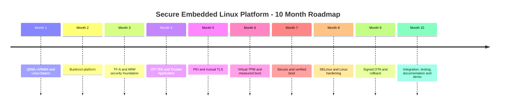

# Project 1 Timeline: Secure Embedded Linux Platform trên QEMU

## 1. Tên project

**Secure Embedded Linux Platform on ARM64 QEMU**

## 2. Giới thiệu ngắn gọn

Project xây dựng một nền tảng Embedded Linux ARM64 có các cơ chế bảo mật xuyên suốt từ quá trình khởi động đến ứng dụng. Toàn bộ môi trường chạy trên QEMU, sử dụng các thành phần mã nguồn mở theo hướng platform thực tế như Buildroot, Trusted Firmware-A, OP-TEE, U-Boot, Linux, `swtpm`, SELinux và một framework OTA.

Project tập trung vào ba năng lực chính:

1. Tự build và tích hợp một embedded platform hoàn chỉnh.
2. Hiểu và triển khai các security building block ở mức hệ thống.
3. Kiểm thử bằng cả trường hợp hợp lệ và trường hợp tấn công/lỗi.

## 3. Kiến trúc mục tiêu

```text
Host Linux
    |
    v
QEMU ARM64
    |
    +--> Trusted Firmware-A / EL3
    |
    +--> OP-TEE / Secure World
    |
    +--> U-Boot
    |
    +--> Linux kernel
    |
    +--> Buildroot root filesystem
    |
    +--> Secure applications and services
    |
    +--> swtpm / virtual TPM
```

## 4. Mục tiêu tổng thể

Sau 10 tháng, project cần đạt được:

- Tự build và boot một Linux ARM64 image trên QEMU.
- Hiểu boot flow, ARM Exception Levels và ranh giới Secure World/Normal World.
- Tích hợp TF-A, OP-TEE, U-Boot, Linux kernel và Buildroot rootfs.
- Viết Linux client gọi một OP-TEE Trusted Application.
- Sinh, lưu và sử dụng key qua TEE hoặc virtual TPM.
- Thiết lập PKI và mutual TLS.
- Xác minh tính toàn vẹn của boot artifact và từ chối image bị sửa.
- Áp dụng SELinux policy theo nguyên tắc least privilege.
- Thực hiện signed OTA update, xử lý lỗi và rollback.
- Có tài liệu kiến trúc, threat model, security tests và hướng dẫn tái tạo project.

## 5. Yêu cầu cuối cùng của project

Project chỉ được xem là hoàn thành khi đáp ứng tất cả các yêu cầu sau.

### 5.1 Yêu cầu chức năng

- QEMU boot được chuỗi platform đã thiết kế.
- Linux vào được shell và chạy được application tùy chỉnh.
- Normal-world client giao tiếp được với OP-TEE Trusted Application.
- Trusted Application thực hiện ít nhất một tác vụ mật mã có sử dụng key được bảo vệ.
- Virtual TPM thực hiện được PCR measurement, sealing/unsealing và signing hoặc attestation.
- Client và server xác thực lẫn nhau bằng mTLS.
- Image hợp lệ boot được, image bị sửa phải bị phát hiện hoặc từ chối tại verification point đã thiết kế.
- SELinux cho phép hành vi hợp lệ và chặn hành vi không được cấp quyền.
- Signed OTA bundle hợp lệ được cài đặt.
- OTA bundle bị sửa hoặc ký sai bị từ chối.
- Có cơ chế recovery hoặc rollback cho update thất bại.

### 5.2 Yêu cầu chất lượng

- Build có thể tái tạo bằng script và README.
- Mỗi security feature có cả positive test và negative test.
- Có log, packet capture hoặc artifact chứng minh kết quả.
- Không commit private key, secret hoặc credential thật vào repository.
- Tách rõ source code, build script, test, key dùng cho lab và tài liệu.
- Ghi rõ giới hạn của QEMU, đặc biệt với eFuse, OTP, physical protection và vendor-specific hardware security.

### 5.3 Bộ tài liệu cuối

```text
README.md
architecture.md
boot-flow.md
threat-model.md
security-requirements.md
security-test-report.md
limitations.md
demo-guide.md
```

---

# 6. Timeline tổng quát trong 10 tháng

> Timeline giả định nhịp học và triển khai đều đặn. Khi một milestone chưa đạt tiêu chí đầu ra, cần hoàn thành nó trước khi ghép thêm thành phần tiếp theo.



## Timeline ngang dạng rút gọn

```text
THÁNG       1          2          3          4          5          6          7          8          9          10
          QEMU      Buildroot     TF-A     OP-TEE    PKI/TLS      TPM     Secure Boot  SELinux      OTA      Integration
           |-----------|-----------|----------|----------|----------|----------|----------|----------|----------|
KẾT QUẢ   Linux      Custom     ARM/EL3     TA +       mTLS      PCR +       Image      Policy     Signed     Final demo
          boots       image      boot flow  secure key              seal      verify     enforce    update     + documents
```

## Tóm tắt nhanh

| Tháng | Trọng tâm | Kết quả chính |
|---:|---|---|
| 1 | QEMU ARM64 + Linux | Boot Linux và vào shell |
| 2 | Buildroot | Tự build kernel, rootfs và package |
| 3 | TF-A + ARM security | Hiểu EL3, SMC và boot flow |
| 4 | OP-TEE | Linux client gọi Trusted Application |
| 5 | PKI + TLS | Mutual TLS với certificate hợp lệ |
| 6 | Virtual TPM | PCR, sealing và TPM-backed operation |
| 7 | Secure/Verified Boot | Image hợp lệ boot, image bị sửa bị chặn |
| 8 | SELinux + hardening | Policy least privilege hoạt động |
| 9 | Secure OTA | Signed update, failure handling và rollback |
| 10 | Integration + portfolio | Demo end-to-end và bộ tài liệu hoàn chỉnh |

---

# 7. Chi tiết theo từng tháng

## Tháng 1: QEMU ARM64 và Linux cơ bản

### Công việc

- Chuẩn bị Linux development environment.
- Cài và kiểm tra QEMU ARM64.
- Boot Linux kernel với một root filesystem tối giản.
- Làm quen với kernel command line, serial console và init process.
- Viết script duy nhất để khởi động VM.
- Lưu boot log và ghi chú đường đi từ QEMU đến shell.

### Kiến thức cần nắm

- QEMU machine model và virtual devices ở mức cơ bản.
- Kernel image, initramfs/rootfs và device tree.
- Kernel command line.
- Serial console.
- Linux boot sequence cơ bản.

### Mục tiêu tháng

```text
QEMU ARM64 -> Linux kernel -> rootfs -> shell
```

**Tiêu chí đạt:** boot ổn định, vào được shell, chạy được `uname -a`, biết chính xác kernel, rootfs và boot arguments nằm ở đâu.

---

## Tháng 2: Buildroot platform

### Công việc

- Lấy source và tạo cấu hình Buildroot cho QEMU ARM64.
- Build toolchain, Linux kernel và root filesystem.
- Tạo một package riêng, ví dụ `security-agent` hoặc `hello-security`.
- Thêm init script hoặc service cho package.
- Tạo script build sạch và script run.
- Ghi lại cấu trúc `output/build`, `output/target` và `output/images`.

### Kiến thức cần nắm

- Cross-compilation và toolchain.
- Buildroot configuration và package infrastructure.
- Kernel/rootfs integration.
- Init system và service startup.
- Reproducible build ở mức project lab.

### Mục tiêu tháng

```text
Buildroot -> custom kernel + custom rootfs + custom package -> QEMU boot
```

**Tiêu chí đạt:** không phụ thuộc image tải sẵn; package tự viết xuất hiện và chạy trong target.

---

## Tháng 3: Trusted Firmware-A và ARM security foundation

### Công việc

- Học ARMv8-A Exception Levels và privilege model.
- Xác định vai trò của EL3, Secure Monitor và SMC.
- Build TF-A cho QEMU `virt` hoặc platform phù hợp với stack đã chọn.
- Quan sát log của TF-A trong boot sequence.
- Vẽ sơ đồ boot stage và execution level.
- Ghi rõ đâu là nền tảng mô phỏng, đâu là hành vi cần phần cứng thật.

### Kiến thức cần nắm

- EL0, EL1, EL2 và EL3.
- Secure state và Non-secure state.
- Secure Monitor Call.
- Trusted Firmware-A boot stages.
- Chain of trust so với boot sequence.

### Mục tiêu tháng

```text
TF-A participates in boot and transfers control to the next stage
```

**Tiêu chí đạt:** tự giải thích được vai trò của TF-A, EL3 và SMC; có boot log và sơ đồ boot flow chính xác với lab.

---

## Tháng 4: OP-TEE và Trusted Application

### Công việc

- Build và tích hợp OP-TEE OS.
- Boot Linux Normal World cùng OP-TEE Secure World.
- Chạy OP-TEE example cơ bản.
- Viết một Linux client và một Trusted Application riêng.
- Trusted Application sinh hoặc sử dụng key để sign/verify dữ liệu.
- Thêm negative tests cho command, parameter hoặc dữ liệu không hợp lệ.

### Kiến thức cần nắm

- Secure World và Normal World.
- OP-TEE OS, client library và supplicant.
- GlobalPlatform TEE Client API/Internal Core API ở mức sử dụng.
- Trusted Application lifecycle.
- Secure storage và trust boundary.

### Mục tiêu tháng

```text
Linux client -> TEE Client API -> OP-TEE TA -> cryptographic operation
```

**Tiêu chí đạt:** TA riêng chạy được; client nhận kết quả đúng; key hoặc sensitive operation không nằm trực tiếp trong logic normal-world application.

---

## Tháng 5: PKI và mutual TLS

### Công việc

- Thiết kế một lab PKI nhỏ gồm Root CA, Intermediate CA nếu cần, server và client certificate.
- Tạo certificate profile và quy tắc đặt identity.
- Xây client/server giao tiếp qua TLS.
- Bật mutual TLS.
- Test certificate không tin cậy, sai identity, hết hạn hoặc không có client certificate.
- Capture traffic để chứng minh payload không truyền plaintext.
- Nếu khả thi, chuẩn bị adapter để private key có thể được bảo vệ bởi TEE hoặc TPM.

### Kiến thức cần nắm

- Public/private key, digital signature và certificate.
- CA hierarchy và certificate chain validation.
- TLS handshake.
- Server authentication và client authentication.
- Key lifecycle cơ bản.

### Mục tiêu tháng

```text
Embedded client <-> mutual TLS <-> server
```

**Tiêu chí đạt:** chỉ client/server có certificate hợp lệ mới kết nối được; có ít nhất ba negative tests và packet capture.

---

## Tháng 6: Virtual TPM và measured boot

### Công việc

- Tích hợp `swtpm` với QEMU.
- Cài TPM2 userspace tools trong image.
- Tạo primary key và TPM-backed key.
- Thực hành PCR read/extend.
- Seal một secret theo PCR state và thử unseal.
- Thay đổi PCR state để chứng minh unseal thất bại.
- Làm attestation hoặc signing demo ở mức lab.
- So sánh verified boot và measured boot.

### Kiến thức cần nắm

- TPM hierarchy, object và handle.
- PCR và measurement.
- Sealing/unsealing.
- Endorsement Key, Attestation Key ở mức khái niệm.
- TPM-backed key và giới hạn của software TPM.

### Mục tiêu tháng

```text
QEMU + swtpm -> PCR measurement -> sealed secret -> controlled unseal
```

**Tiêu chí đạt:** secret chỉ được unseal trong PCR state dự kiến; có log và script tái tạo toàn bộ demo.

---

## Tháng 7: Secure/Verified Boot

### Công việc

- Chọn verification point và định dạng artifact, ví dụ U-Boot FIT image.
- Thiết kế key hierarchy dành cho boot artifact.
- Ký kernel, DTB hoặc image bundle theo thiết kế.
- Xác minh chữ ký trước khi chuyển quyền thực thi.
- Tạo tampered image và unsigned image để kiểm thử.
- Tài liệu hóa trust anchor trong lab.
- Ghi rõ rằng QEMU chưa cung cấp eFuse/OTP root of trust như SoC thật.

### Kiến thức cần nắm

- Image signing và signature verification.
- Hash, certificate và public-key trust.
- Chain of trust.
- Verified boot so với measured boot.
- Anti-rollback ở mức thiết kế.

### Mục tiêu tháng

```text
Valid signed image -> accepted
Tampered or invalid image -> rejected
```

**Tiêu chí đạt:** có bằng chứng cho cả luồng chấp nhận và từ chối; mô tả đúng trust anchor và giới hạn mô phỏng.

---

## Tháng 8: SELinux và Linux hardening

### Công việc

- Bật SELinux trong kernel và root filesystem.
- Chạy hệ thống ở chế độ phù hợp để quan sát và tinh chỉnh policy.
- Tạo domain/type riêng cho application mẫu.
- Chỉ cấp quyền tối thiểu cần thiết.
- Chặn application đọc file, mở socket hoặc truy cập resource ngoài phạm vi.
- Giảm Linux capabilities và quyền của service.
- Kiểm tra compiler/system hardening phù hợp với image.

### Kiến thức cần nắm

- Discretionary Access Control và Mandatory Access Control.
- SELinux subject, object, type, domain và policy rule.
- AVC denial.
- Least privilege.
- Process isolation, capabilities và read-only protection.

### Mục tiêu tháng

```text
Allowed operation -> success
Unauthorized operation -> SELinux denial
```

**Tiêu chí đạt:** policy tự viết hoạt động ở enforcing mode; có AVC log và test chứng minh policy không quá rộng.

---

## Tháng 9: Signed OTA, recovery và rollback

### Công việc

- Chọn RAUC hoặc SWUpdate.
- Thiết kế image layout A/B hoặc recovery strategy tương đương.
- Tạo version 1 và version 2 của system image.
- Tạo và ký update bundle.
- Xác minh bundle trước khi cài.
- Quản lý boot success/failure.
- Test bundle bị sửa, chữ ký sai và update bị gián đoạn.
- Thực hiện recovery hoặc rollback.
- Ghi lại version policy và giới hạn anti-rollback của lab.

### Kiến thức cần nắm

- OTA lifecycle.
- Signed metadata/artifact.
- A/B update strategy.
- Atomicity, recovery và rollback.
- Bootloader/update-agent coordination.
- Version và rollback policy.

### Mục tiêu tháng

```text
Version 1 -> verified update -> Version 2
Failed or invalid update -> reject or rollback safely
```

**Tiêu chí đạt:** update hợp lệ thành công; bad update bị từ chối; có ít nhất một failure scenario dẫn tới recovery/rollback.

---

## Tháng 10: Tích hợp, kiểm thử, tài liệu và portfolio

### Công việc

- Làm sạch repository và chuẩn hóa build/run scripts.
- Chạy lại toàn bộ project từ clean environment nếu có thể.
- Tích hợp các demo thành một luồng end-to-end.
- Hoàn thiện architecture, boot flow và trust boundaries.
- Viết threat model và security requirement mapping.
- Hoàn thiện positive/negative security test matrix.
- Ghi rõ limitations của QEMU và phần chưa cover.
- Chuẩn bị demo script và ảnh/log cần thiết cho README.
- Viết phần mô tả CV trung thực, không claim kinh nghiệm hardware hoặc Qualcomm thực tế.

### Kiến thức cần nắm

- System integration.
- Threat modeling và attack surface.
- Security validation.
- Evidence-based engineering documentation.
- Reproducibility và portfolio presentation.

### Mục tiêu tháng

```text
One reproducible repository + one end-to-end demo + complete technical documentation
```

**Tiêu chí đạt:** người khác có thể đọc README, build/run project và hiểu bằng chứng của từng security control; toàn bộ yêu cầu cuối project được kiểm tra bằng checklist.

---

# 8. Final acceptance checklist

## Platform

- [ ] QEMU ARM64 boot ổn định.
- [ ] Kernel và rootfs do Buildroot tạo.
- [ ] Có custom package/application.
- [ ] TF-A xuất hiện đúng trong boot flow.
- [ ] OP-TEE hoạt động cùng Linux Normal World.

## Security features

- [ ] Trusted Application riêng hoạt động.
- [ ] Có protected cryptographic operation hoặc secure storage.
- [ ] mTLS hoạt động và có negative tests.
- [ ] `swtpm` có PCR, seal/unseal và TPM-backed operation.
- [ ] Signed image hợp lệ được chấp nhận.
- [ ] Tampered/invalid image bị phát hiện hoặc từ chối.
- [ ] SELinux policy chạy ở enforcing mode.
- [ ] Signed OTA thành công.
- [ ] Invalid OTA bị từ chối.
- [ ] Failure scenario có recovery/rollback.

## Engineering quality

- [ ] Build và run bằng script.
- [ ] Không chứa private key/secret thật trong Git.
- [ ] Mỗi feature có positive và negative test.
- [ ] Có log hoặc artifact chứng minh kết quả.
- [ ] Có architecture diagram và boot-flow diagram.
- [ ] Có threat model và security-test report.
- [ ] Có tài liệu limitations của QEMU.
- [ ] README đủ để người khác tái tạo lab.

## Portfolio outcome

Kết quả cuối nên có thể được mô tả ngắn gọn như sau:

> Built a reproducible ARM64 secure embedded Linux platform on QEMU using Buildroot, Trusted Firmware-A, OP-TEE, U-Boot, virtual TPM, SELinux, mutual TLS and signed OTA updates. Implemented positive and negative security tests for boot integrity, protected key operations, access control and update recovery.
